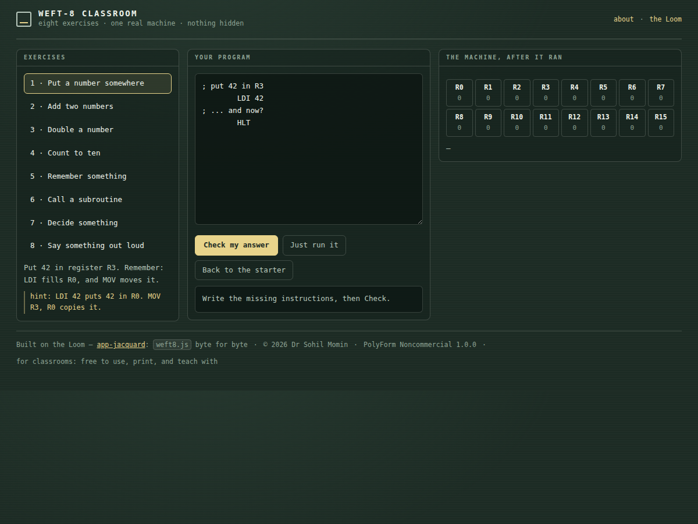

<div align="center">

# Weft-8 Classroom

<!-- shot:start -->



<!-- shot:end -->

**Nine exercises that teach how a computer actually works — on a real one.**

[](https://drsamonline.github.io/weft8-classroom/)
[](https://github.com/drsamonline/weft8-classroom/actions/workflows/test.yml)
[](https://github.com/drsamonline/weft8-classroom/actions/workflows/build-apps.yml)
[](LICENSE)
[-e8d48b?style=flat-square&labelColor=1c2b24)](https://github.com/drsamonline/app-jacquard)
[](#for-teachers)

[**Open the exercises →**](https://drsamonline.github.io/weft8-classroom/) · [Teacher's sheet](TEACHER.md)

</div>


A first lesson in how computers work, built on the **Weft-8** — the 8-bit machine from
[Jacquard, the Loom](https://github.com/drsamonline/app-jacquard). Sixteen registers, four flags,
twenty-seven instructions, and **no `if` statement**, so the student builds one.

Every exercise starts **incomplete**. The machine runs, does something, and the class can see exactly what
is missing — then the check names the register and the value that was expected.

## The nine exercises

| # | Exercise | What it teaches |
|---|---|---|
| 1 | Put a number somewhere | `LDI` fills the accumulator, `MOV` moves it |
| 2 | Add two numbers | what `ADD Ra, Rb` really means |
| 3 | Double a number | `SHL` is multiply-by-two |
| 4 | Count to ten | a loop needs a counter, a decrement and a branch |
| 5 | Remember something | `STORE` and `LOAD` reach RAM at `0x80` |
| 6 | Call a subroutine | `CALL` pushes, `RET` pops — and the code after the call proves you came back |
| 7 | Decide something | `CMP` sets the flags, `JZ` branches: your first `if` |
| 8 | Say something out loud | `OUT` hands a byte to a port |
| 9 | Swap two registers | why a swap needs a third register — and why "just copy it" loses a value |

## For teachers

[`TEACHER.md`](TEACHER.md) has the lesson plan, the answers in words, three things worth saying out loud,
and a table of common mistakes with what they look like on screen and what to ask the student.

Two properties make it usable in a real classroom:

- **Offline, one file, no accounts.** A room with no internet and a decade-old laptop can run the whole
  lesson. There is nothing to install.
- **No partial credit.** The machine has no partial answers, so a tick means the program is right — not
  that it looks right.

## Built on the Loom

`docs/play/weft8.js` is the **Weft-8** from [app-jacquard](https://github.com/drsamonline/app-jacquard),
byte for byte the same engine. A student who finishes these eight can open Jacquard, or the puzzle set in
`app-weft-puzzles`, and it is the same computer.

## Test it

```
npm install
node test-node.js          # 72 assertions — the machine, every exercise, and the checks
node tests/page-smoke.js   # 10 assertions — the page, driven in jsdom
```

The suite asserts the three things a teaching pack must be able to promise:

1. **every exercise is solvable** — the shipped answer passes its own checks, on the real machine
2. **every starter is genuinely incomplete** — it must *fail*, or there is nothing to teach
3. **the checks bite** — subtracting instead of adding, forgetting to `LOAD` back, ending a subroutine
   with `HLT` instead of `RET`, and writing one byte when two were asked for are all caught, each with the
   message a teacher would give


## The Weft-8 family

One machine, seven faces. Every one of these runs `weft8.js` from the Loom, byte for byte —
learn it once and you have learned all seven.

| | what it is |
|---|---|
| [the Loom](https://drsamonline.github.io/app-jacquard/) | the machine and its editor — where it all starts |
| [Weft Puzzles](https://drsamonline.github.io/app-weft-puzzles/) | five puzzles solved in assembly, a robot on a grid |
| [Clip Loom](https://drsamonline.github.io/app-clip-loom/) | clipboard programs you can read: strip, squeeze, wrap |
| [Weft-8 on hardware](https://drsamonline.github.io/weft8-hardware/) | the same machine in C, three-way parity with the JS one |
| [weft8-kit](https://drsamonline.github.io/weft8-kit/) | rules small enough to sign off |
| **Weft-8 Classroom** (you are here) | eight exercises that teach how a computer works |
| [Weft-8 beside x86 and ARM](https://drsamonline.github.io/weft8-compare/) | the same four jobs in three machines |

<!-- support:sweep -->
## Support

| | |
|---|---|
| UPI (India) | `drsohilboi@ybl` — payee Dr Sohil Momin, open amount, or scan [the QR](docs/assets/upi-qr.svg) |
| GitHub Sponsors | [github.com/sponsors/drsamonline](https://github.com/sponsors/drsamonline) |
| Ko-fi | [ko-fi.com/matneo](https://ko-fi.com/matneo) |
| PayPal | [paypal.me/drsohilmomin](https://paypal.me/drsohilmomin?locale.x=en_GB&country.x=IN) |
| My books | [Amazon author store](https://www.amazon.com/stores/author/B08ZT331LY/allbooks?ccs_id=aed72b9f-71d9-41dc-adee-e9368a317acc) |
| More apps | [drsamonline.github.io](https://drsamonline.github.io/) |
| Email | [sohilmomin2000@gmail.com](mailto:sohilmomin2000@gmail.com) |

## Licence

**PolyForm Noncommercial 1.0.0** · © 2026 Dr Sohil Momin. Free for any noncommercial purpose, including
classrooms; commercial use needs a licence from the author.
